# Configurando e usando o app Financeiro

Este guia tem duas partes. A primeira leva os dados obtidos no [guia da Pluggy](configurar-pluggy.md) (Client ID,
Client Secret e `itemId` de cada banco) para o app. A segunda apresenta cada tela do sistema e o que dá para fazer nela.

> Vai usar sem conectar banco? Pule a Parte 1. O app funciona só com o que você cadastra em Entradas e Contas a pagar
> (veja [Duas origens](#6-menu-mês-e-sincronização)).

> Os prints usam dados simulados. Nomes, valores e `itemId` são de exemplo.

## Sumário

**Parte 1 — Configurar os bancos no app**

1. [O que você precisa ter em mãos](#1-o-que-você-precisa-ter-em-mãos)
2. [Preencher o .env](#2-preencher-o-env)
3. [Subir ou reiniciar o container](#3-subir-ou-reiniciar-o-container)
4. [Conferir se a Pluggy foi reconhecida](#4-conferir-se-a-pluggy-foi-reconhecida)
5. [Cadastrar os bancos (itemId)](#5-cadastrar-os-bancos-itemid)

**Parte 2 — Conhecendo o sistema**

6. [Menu, mês e sincronização](#6-menu-mês-e-sincronização)
7. [Dashboard](#7-dashboard)
8. [Lançamentos](#8-lançamentos)
9. [Histórico](#9-histórico)
10. [Parcelas e previsão](#10-parcelas-e-previsão)
11. [Contas a pagar](#11-contas-a-pagar)
12. [Entradas](#12-entradas)
13. [Configurações](#13-configurações)
14. [Regras automáticas](#14-regras-automáticas)

**Ajuda**

15. [Solução de problemas](#15-solução-de-problemas)

---

# Parte 1 — Configurar os bancos no app

## 1. O que você precisa ter em mãos

| Dado | Onde pegar | Vai para |
|---|---|---|
| Client ID | Dashboard → Aplicações ([passo 5](configurar-pluggy.md#5-conferir-a-aplicação-e-as-credenciais)) | `.env` |
| Client Secret | Gerado no onboarding ou em "Gerar novo secret" ([passo 4](configurar-pluggy.md#4-onboarding-do-dashboard-e-client-secret)) | `.env` |
| `itemId` de cada banco | Demo da aplicação, conector MeuPluggy ([passo 7](configurar-pluggy.md#7-gerar-o-itemid-de-cada-banco)) | Tela Configurações do app |

## 2. Preencher o .env

Na raiz do projeto, crie o `.env` a partir do exemplo (se ainda não existir) e preencha as credenciais:

```bash
cp .env.example .env
```

```env
PLUGGY_CLIENT_ID=xxxxxxxx-xxxx-xxxx-xxxx-xxxxxxxxxxxx
PLUGGY_CLIENT_SECRET=seu-client-secret
```

As outras variáveis (`APP_PORT`, `APP_HTTP_PORT`, `SYNC_DAYS_BACK`, `SYNC_INTERVAL_HOURS`) já vêm com valores padrão
e são opcionais.
O `.env` está no `.gitignore` e nunca deve ir para o repositório.

## 3. Subir ou reiniciar o container

```bash
docker compose up -d
```

O container lê o `.env` só ao iniciar. Sempre que alterar o `.env`, rode o comando de novo.
Na primeira vez, ou depois de atualizar o código, use `docker compose up -d --build`.

## 4. Conferir se a Pluggy foi reconhecida

Abra **http://financeiro.localhost** (ou http://localhost:47815) e vá em **Configurações**. O endereço
`financeiro.localhost` funciona sem configurar nada: o navegador manda qualquer `*.localhost` para a sua máquina.

Sem credenciais, aparece o aviso amarelo **"Pluggy não configurada"**, o rodapé do menu mostra "Pluggy não configurada"
e o botão **Sincronizar agora** fica desabilitado:

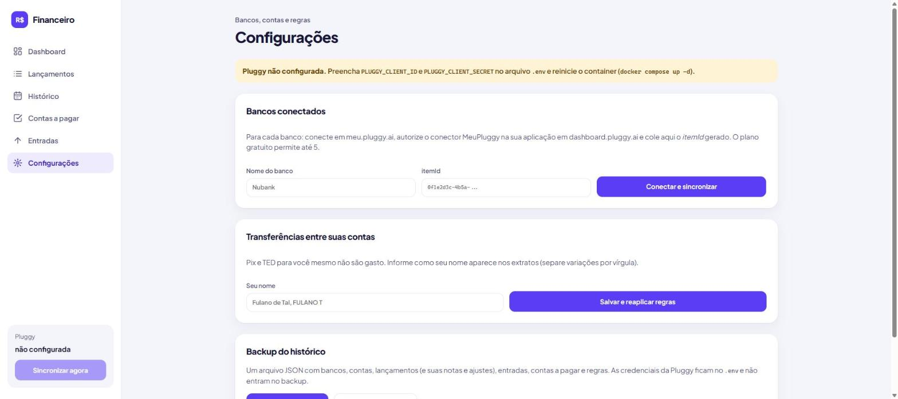

Com as credenciais certas, o aviso some e o rodapé mostra a última sincronização:

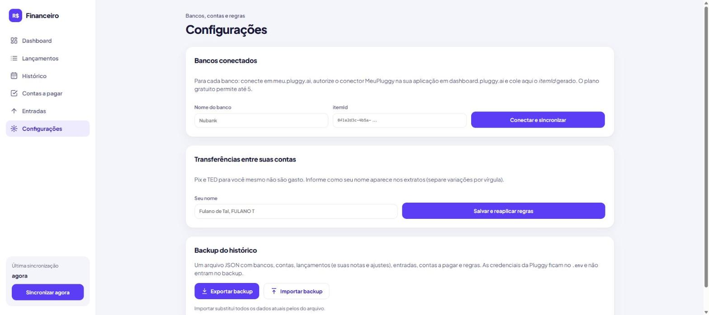

## 5. Cadastrar os bancos (itemId)

Em **Configurações → Bancos conectados**:

1. Em **Nome do banco**, digite como quer ver o banco no app (ex.: `Nubank`).
2. Em **itemId**, cole o UUID copiado do Demo da Pluggy.
3. Clique em **Conectar e sincronizar**.


O banco aparece na lista, com as iniciais e o status da Pluggy (`UPDATED`), e as contas e cartões dele aparecem logo abaixo:

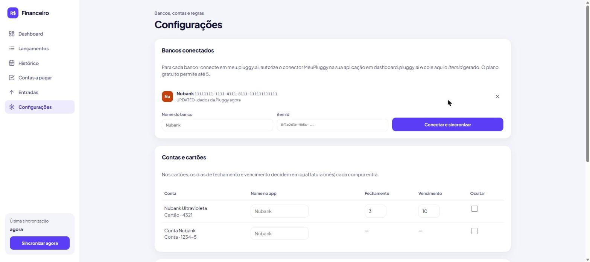

Repita para cada banco, até 5 no plano gratuito. Para terminar a configuração, vale fazer duas coisas em
[Configurações](#13-configurações): conferir o **fechamento e o vencimento dos cartões** e informar **seu nome**, para
o app ignorar as transferências entre suas contas.

---

# Parte 2 — Conhecendo o sistema

## 6. Menu, mês e sincronização

O menu lateral fica sempre visível e leva a todas as telas. No topo de cada tela fica o título e, quando a tela é de
um mês, o seletor de mês.

**O que dá para fazer**

- Trocar de tela pelo menu: Dashboard, Lançamentos, Histórico, Parcelas e previsão, Contas a pagar, Entradas e
  Configurações.
- Trocar de mês pelas setas **‹ ›** no topo. O mês escolhido vale para todas as telas, e **Hoje** volta ao mês atual.
- Ver no rodapé do menu quando foi a última sincronização e se ela falhou.
- Clicar em **Sincronizar agora** para buscar os dados dos bancos na hora. Sem nenhum banco conectado, o rodapé mostra
  **Bancos · opcional** e um link para conectar o Meu Pluggy, no lugar do botão.
- Contar com a sincronização automática: o app sincroniza ao iniciar e a cada `SYNC_INTERVAL_HOURS` horas (padrão: 6),
  e as telas se atualizam sozinhas quando ela termina.

A Pluggy atualiza os dados dos bancos 1 vez por dia, então sincronizar mais vezes não traz dados mais novos que isso.
A primeira sincronização de cada conta busca os últimos `SYNC_DAYS_BACK` dias (padrão: 90).

**Duas origens: dos bancos e por você.** Todo valor que sai tem uma origem, e as telas separam as duas com cor e ícone:

- **Dos bancos** (roxo, ícone de banco): o que o Meu Pluggy traz, como cartões, Pix, boletos, faturas e saldos.
- **Cadastrado por você** (rosa, ícone de lápis): o que você lança no app, como as contas a pagar marcadas como pagas,
  as entradas e as parcelas "Por X meses".

O **total sempre soma as duas** ("Dos bancos R$ X + Por você R$ Y = total"). Quando o pagamento de uma conta paga à mão
aparece depois no banco, ela passa sozinha para "Dos bancos" e não conta duas vezes.

**Sem o Meu Pluggy o app funciona igual**, só com o que você cadastra: a parte "Dos bancos" vira um quadro **opcional**
com o link para conectar, e as colunas dos bancos somem do Histórico e da Previsão. Dá para usar só com Entradas e
Contas a pagar.

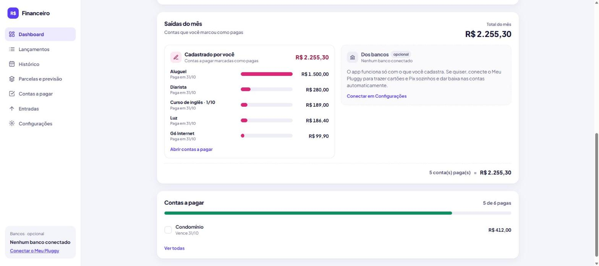

**Selo "Funcionalidade MeuPluggy".** Enquanto o Meu Pluggy não estiver pronto (sem credenciais no `.env` ou sem
nenhum banco cadastrado), as partes que dependem dos dados dos bancos mostram um selo vermelho claro com **!**. Passe o
mouse sobre ele para ver o que falta configurar; clicar leva para Configurações. O selo some sozinho quando há
credenciais e ao menos um banco.

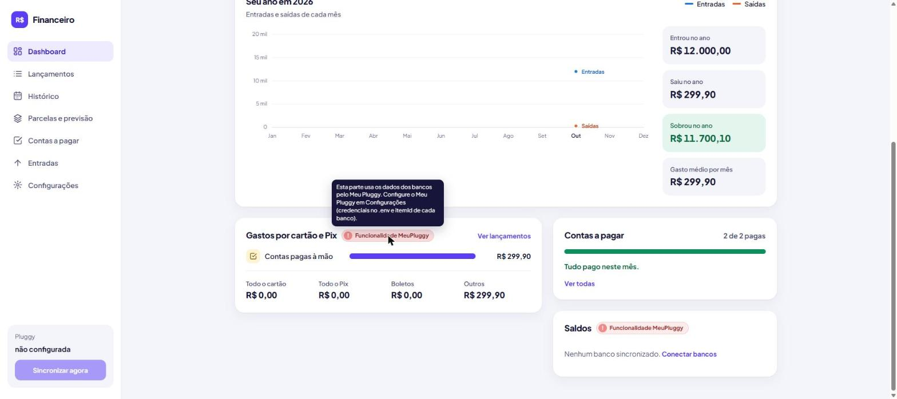

Onde ele aparece: em Lançamentos e em **Bancos conectados** (Configurações). Entradas, Contas a pagar, Dashboard,
Histórico e Parcelas e previsão funcionam também só com o que você cadastra.

## 7. Dashboard

A tela inicial: o resumo do mês escolhido, para saber em segundos se o mês está positivo ou negativo, para onde foi o
dinheiro e o que falta pagar.

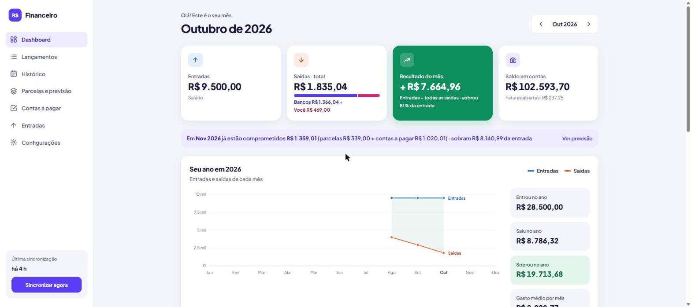

**O que dá para fazer**

- Ver **Entradas**, **Saídas · total** (com uma barrinha e o valor de cada origem: "Bancos R$ X + Você R$ Y"),
  **Resultado do mês** (entradas menos todas as saídas; verde quando positivo, vermelho quando negativo, com quanto
  sobrou da entrada) e **Saldo em contas**, com o total investido e o das faturas abertas. Sem banco conectado, o
  último bloco vira **Falta pagar**, com o que ainda está em aberto em Contas a pagar.
- Acompanhar o ano em **Seu ano**: uma linha de entradas (azul) e uma de saídas (laranja) por mês, com a sobra
  sombreada entre elas. Passe o mouse sobre um mês para ver entradas, saídas e sobra.
- Ver quanto do **próximo mês já está comprometido** com parcelas e contas a pagar, no aviso logo abaixo do resumo
  (leva para [Parcelas e previsão](#10-parcelas-e-previsão)).
- Ver os totais do ano: quanto entrou, saiu e sobrou e o gasto médio por mês.
- Ver as **Saídas do mês** separadas pela origem, com o total do mês no topo e a conta no rodapé
  ("Dos bancos + Por você = total"):
  - **Dos bancos**: os gastos por cartão e Pix de cada banco (ex.: Cartão Nubank, Pix Santander) e os totais por meio.
  - **Cadastrado por você**: as contas marcadas como pagas sem lançamento do banco, uma a uma (veja
    [Contas a pagar](#11-contas-a-pagar)).
- Ver as **contas a pagar** pendentes, com barra de progresso e as vencidas em vermelho.
- Ver os **Saldos** de cada banco (só aparece com banco conectado): conta corrente, fatura aberta de cada cartão (com o limite disponível) e
  **investimentos**, um a um (nome, tipo e vencimento) e somados. No rodapé, o total em contas, o total investido e a
  soma dos dois. Os investimentos aparecem quando a Pluggy os envia para aquele banco; se não enviar, o bloco avisa.
- Ir direto para Lançamentos, Contas a pagar ou Entradas pelos links de cada bloco.

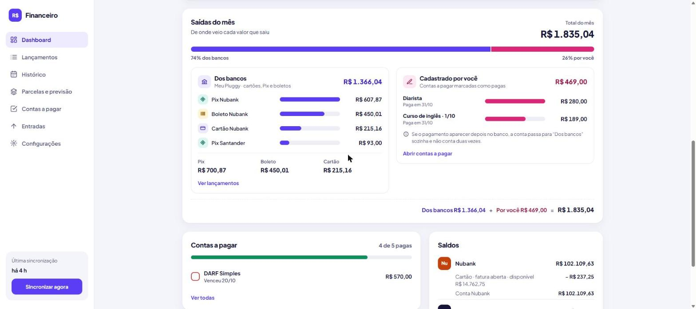

## 8. Lançamentos

Tudo o que veio dos bancos no mês escolhido, numa lista só. É aqui que você confere e corrige o que o app classificou.

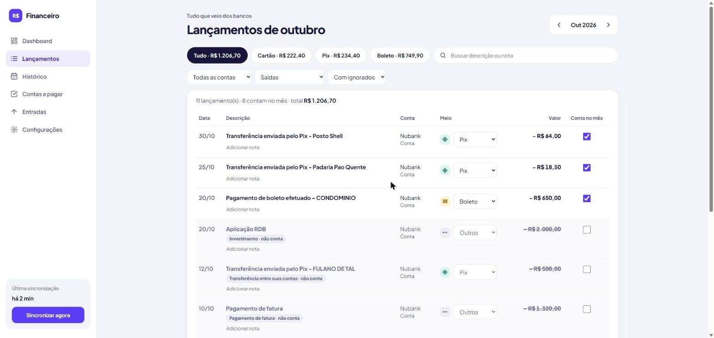

**O que dá para fazer**

- Filtrar por meio com os botões do topo (Tudo, Cartão, Pix, Boleto…), que já mostram o total de cada um.
- Buscar por descrição ou nota.
- Filtrar por conta, por tipo (saídas, entradas e estornos, ou tudo) e por ignorados (com, sem ou só eles).
- Trocar o **meio de pagamento** de um lançamento da conta corrente quando a detecção errar.
- Marcar ou desmarcar **Conta no mês**, para contar ou não contar um lançamento como gasto.
- **Adicionar uma nota** a qualquer lançamento (ex.: "presente de aniversário").
- Ver as **etiquetas**: pendente, parcela (ex.: 2/5), fatura de outro mês e o motivo de um lançamento ter sido ignorado.

As correções manuais sempre vencem as [regras automáticas](#14-regras-automáticas) e são mantidas nas sincronizações.

## 9. Histórico

A visão de longo prazo: como foi cada ano e cada mês, para comparar períodos e achar onde o dinheiro foi.

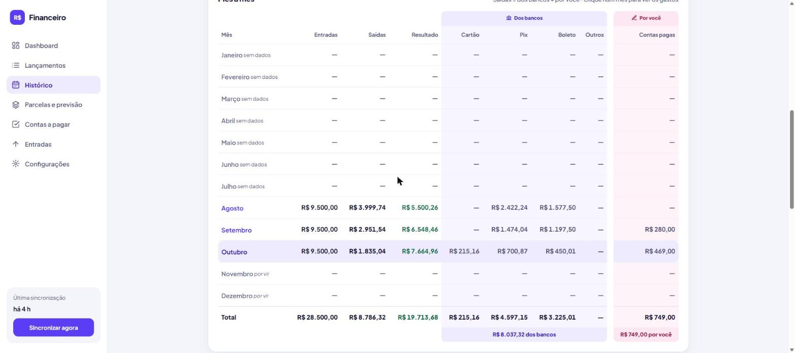

**O que dá para fazer**

- Escolher o ano pelas setas ou pelos botões de ano.
- Ver quanto entrou, saiu (com a parte dos bancos e a sua) e sobrou no ano e o gasto médio por mês.
- Ver o gráfico de entradas e saídas do ano, com o detalhe de cada mês ao passar o mouse.
- Comparar os meses na tabela **Mês a mês**: entradas, saídas, resultado e, agrupadas, as colunas **Dos bancos**
  (cartão, Pix, boleto e outros) e **Por você** (contas pagas). O rodapé traz o total do ano de cada coluna e o
  subtotal de cada grupo. Sem banco conectado, as colunas dos bancos somem.
- Clicar num mês para abrir o detalhe: as saídas separadas em "Dos bancos" e "Cadastrado por você", como no Dashboard,
  e os maiores gastos do mês, cada um com a sua origem.
- Ir do detalhe para os **Lançamentos** ou para o **Dashboard** daquele mês.

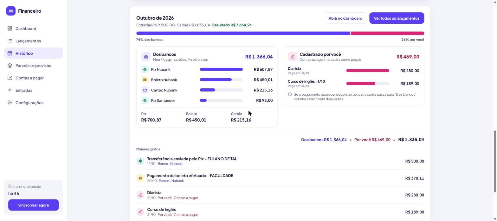

## 10. Parcelas e previsão

O que já está comprometido nos próximos meses: as compras parceladas nos cartões e uma previsão de quanto vai sobrar,
mês a mês, somando parcelas, contas a pagar e, se você quiser, a média dos gastos do dia a dia.

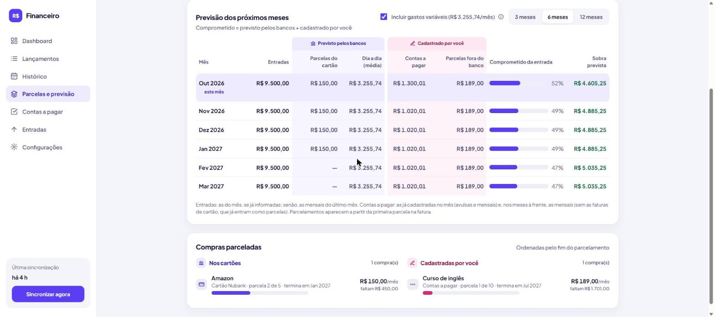

**O que dá para fazer**

- Ver quanto **falta pagar em parcelas** no total, quanto cai **neste mês**, quanto já está **comprometido no próximo**
  (parcelas + contas a pagar) e em que mês você fica **livre de parcelas**.
- Ver a **previsão** de 3, 6 ou 12 meses: entradas; **Previsto pelos bancos** (parcelas do cartão e a média do dia a
  dia); **Cadastrado por você** (contas a pagar e parcelas fora do banco); quanto da entrada já está comprometido
  (barra e %) e a **sobra prevista**. Sem banco conectado, só aparecem as colunas do que você cadastrou.
- Ligar ou desligar **Incluir gastos variáveis**: a média dos últimos 3 meses de tudo que contou como gasto, tirando
  parcelas e contas a pagar (mercado, Pix, compras à vista…). Desligado, a previsão mostra só o que já é certo.
- Ver cada **compra parcelada**, em duas listas (**Nos cartões** e **Cadastradas por você**): cartão, parcela atual (ex.: 3 de 10), valor por mês, quanto falta e em que mês
  termina, com uma barra de progresso. A última parcela ganha a etiqueta **última parcela**.
- Na lista **Cadastradas por você** ficam as compras parceladas fora do banco, cadastradas em Contas a pagar com
  "Por X meses".
- No Dashboard, o aviso "Em [mês] já estão comprometidos…" mostra o próximo mês e leva para esta tela.

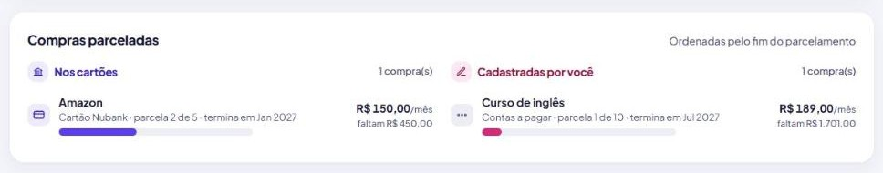

Como a previsão é montada:

| Parte | De onde vem |
|---|---|
| Entradas | As do mês, se já informadas; senão, as entradas mensais do último mês que tem alguma |
| Parcelas do cartão | Cada compra parcelada no cartão projetada até a última parcela, no mês da fatura |
| Parcelas fora do banco | As contas "Por X meses" de Contas a pagar |
| Contas a pagar | As contas de [Contas a pagar](#11-contas-a-pagar) já cadastradas no mês, avulsas ou mensais; nos meses à frente, também as mensais que ainda vão ser criadas. Ficam de fora as faturas de cartão e as contas "Por X meses", que já contam nas parcelas |
| Gastos variáveis | Média dos últimos 3 meses com dados, sem parcelas e sem pagamentos de contas a pagar |

Limitações:
- **O parcelamento só aparece depois da primeira parcela na fatura.** Uma compra parcelada hoje entra quando a Pluggy
  mandar a parcela 1.
- **Cada parcela chega como um lançamento por mês.** O app junta tudo numa compra só (cartão, descrição sem o "x/y",
  valor da parcela e total de parcelas). Se o banco mudar a descrição de um mês para outro, a compra pode aparecer duas
  vezes.
- **O número da parcela** vem da Pluggy ou, se ela não mandar, da descrição, mas só quando ela traz a palavra
  "parcela" (ex.: "Parcela 3/10" ou "PARC 02/03"). Um "05/10" solto pode ser uma data e é ignorado.
- **Adiantamento, cancelamento ou juros** só aparecem quando vierem do banco.

## 11. Contas a pagar

Um checklist das contas do mês (internet, financiamento, impostos…), que se marca sozinho quando o pagamento aparece
no extrato. As faturas dos cartões entram sozinhas, e o app sugere as contas que encontrar se repetindo.

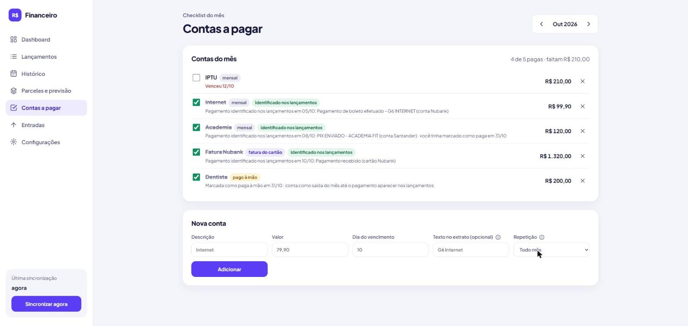

**O que dá para fazer**

- Ver as **faturas dos cartões** como contas, criadas sozinhas a cada sincronização, com vencimento e valor vindos
  da Pluggy (etiqueta roxa "fatura do cartão · do banco"). A fatura é marcada como paga quando o pagamento dela aparece no cartão ou
  na conta corrente. Enquanto a fatura ainda está aberta, o valor aparece como **valor parcial** e é atualizado até
  o fechamento.
- Aceitar as **sugestões de contas que se repetem**: saídas da conta corrente que aparecem em pelo menos 3 meses, com
  valor parecido (até 20% de diferença) e no mesmo dia do mês (±5 dias). **Adicionar** cria a conta mensal já com o
  texto para a baixa automática; **Ignorar** tira a sugestão de vez.
- Cadastrar uma conta com descrição, valor (opcional) e dia do vencimento.
- Escolher a **Repetição**: **Todo mês** (a conta é criada sozinha nos meses seguintes), **Por X meses** (de 2 a 120)
  ou **Só este mês**.
- Usar **Por X meses** para compras parceladas **fora do banco** (no dinheiro, no carnê…): a conta aparece em cada mês
  com a etiqueta da parcela da vez (ex.: "parcela 2/10") e some depois da última. Ela também entra na lista de compras
  parceladas de [Parcelas e previsão](#10-parcelas-e-previsão), na lista "Cadastradas por você".
- Informar um **texto no extrato** (ex.: `G6 Internet`). Se ele aparecer numa saída do mês, a conta é marcada como paga e o
  app mostra qual lançamento deu a baixa.
- Marcar ou desmarcar uma conta à mão. Ao desmarcar, a baixa automática daquela conta é desligada.
- Ver **como cada conta foi paga**, pela etiqueta ao lado do nome:

  | Etiqueta | Quando aparece | Texto embaixo |
  |---|---|---|
  | **identificado nos lançamentos** (verde) | O pagamento foi encontrado nos lançamentos do banco, sozinho ou depois de você marcar | "Pagamento identificado nos lançamentos em [data]: [descrição do lançamento] (conta/cartão [banco])". Se você tinha marcado antes, acrescenta "você tinha marcado como paga em [data]" |
  | **pago à mão** (amarela) | Você marcou como paga e nenhum lançamento foi ligado a ela | "Marcada como paga à mão em [data] · conta como saída do mês até o pagamento aparecer nos lançamentos" |
- Contar como **saída** uma conta paga fora dos bancos conectados (no dinheiro, ou antes de conectar a Pluggy): ao
  marcar como paga uma conta que não tem lançamento do banco ligado a ela, o valor entra nas saídas do mês, em
  **Cadastrado por você**. Se depois o pagamento aparecer no extrato (pelo texto do extrato), o lançamento é ligado à
  conta e ela deixa de contar sozinha, para não somar duas vezes. Faturas de cartão não contam assim: as compras do
  cartão já entram nas saídas.
- Ver o que falta pagar no mês e o que já venceu (em vermelho).
- Remover uma conta. Numa conta que se repete, o app pergunta se é para parar de repetir ou remover só deste mês. Uma
  fatura de cartão removida fica oculta só naquele mês; as dos meses seguintes continuam aparecendo.

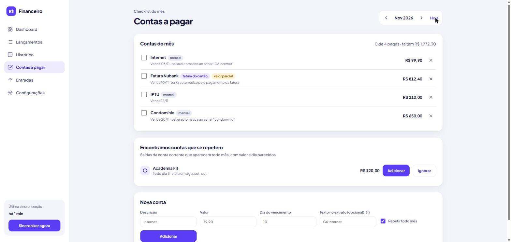

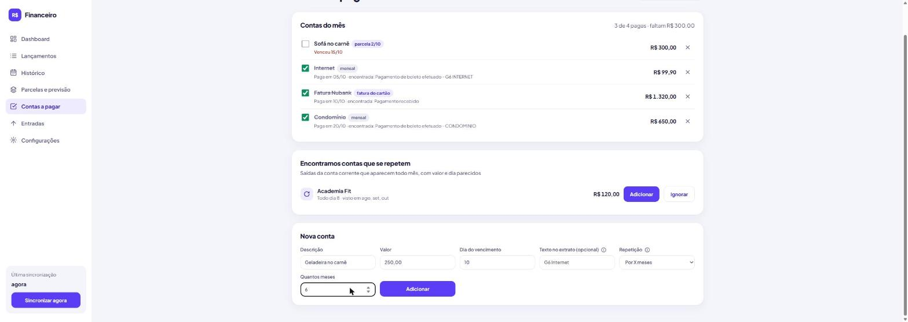

| Campo | Exemplo | Observação |
|---|---|---|
| Descrição | Internet | |
| Valor | 79,90 | Opcional; use o valor esperado (numa compra parcelada, o valor de cada parcela) |
| Dia do vencimento | 5 | Ajustado para o último dia em meses mais curtos |
| Texto no extrato | G6 Internet | Opcional; dá baixa automática |
| Repetição | Todo mês | Todo mês, Por X meses ou Só este mês |
| Quantos meses | 10 | Só em "Por X meses": total de parcelas, contando o mês atual como a 1ª |

## 12. Entradas

O único dado digitado à mão: quanto entrou no mês. É ele que, comparado com as saídas, diz se o mês ficou positivo
ou negativo.

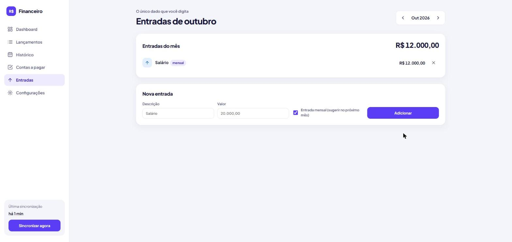

**O que dá para fazer**

- Cadastrar uma entrada com descrição e valor (aceita `20.000,00` ou `20000.00`).
- Marcar **Entrada mensal** para ela ser sugerida nos meses seguintes.
- Clicar em **Repetir** num mês sem entradas, para copiar as entradas mensais do último mês que tem alguma.
- Remover uma entrada.

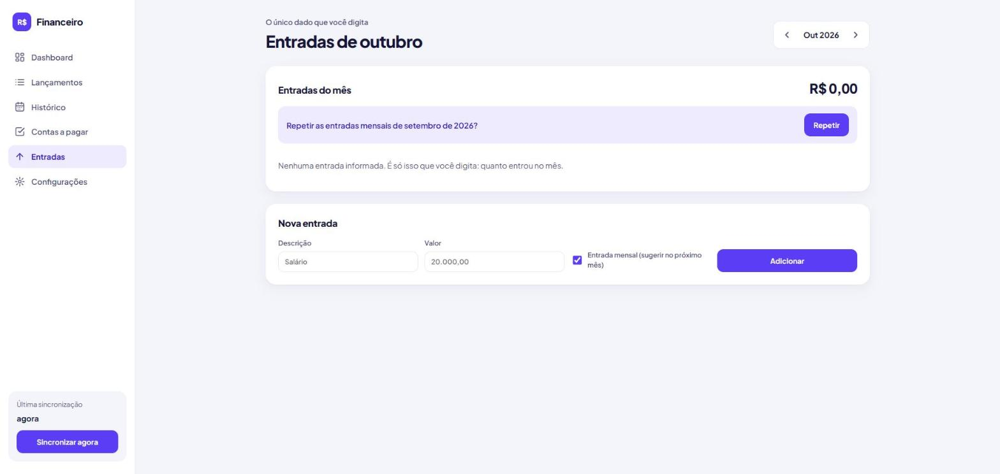

## 13. Configurações

Onde ficam os bancos conectados, os ajustes de contas e cartões, as regras de transferência e o backup.

**O que dá para fazer**

- **Bancos conectados:** cadastrar um banco pelo `itemId` (veja o [passo 5](#5-cadastrar-os-bancos-itemid)), ver o
  status de cada um e remover um banco junto com os lançamentos dele.
- **Contas e cartões:** dar outro nome a uma conta no app, ocultar uma conta do dashboard e dos totais (ex.: conta
  zerada) e ajustar os dias de **fechamento e vencimento** de cada cartão, que decidem em qual fatura (mês) cada
  compra entra. As alterações são salvas ao sair do campo.
- **Transferências entre suas contas:** informar seu nome como aparece nos extratos (variações separadas por vírgula,
  ex.: `Fulano de Tal, FULANO T`) e clicar em **Salvar e reaplicar regras**. Pix e TED para você mesmo deixam de
  contar como gasto, inclusive nos lançamentos que já estão no app.
- **Backup do histórico:** **Exportar backup** baixa um arquivo `financeiro-backup-AAAA-MM-DD.json` com tudo o que está
  no app. **Importar backup** lê um desses arquivos e **substitui todos os dados atuais** pelos dele, depois de pedir
  confirmação. Se o arquivo tiver qualquer problema, nada é alterado.

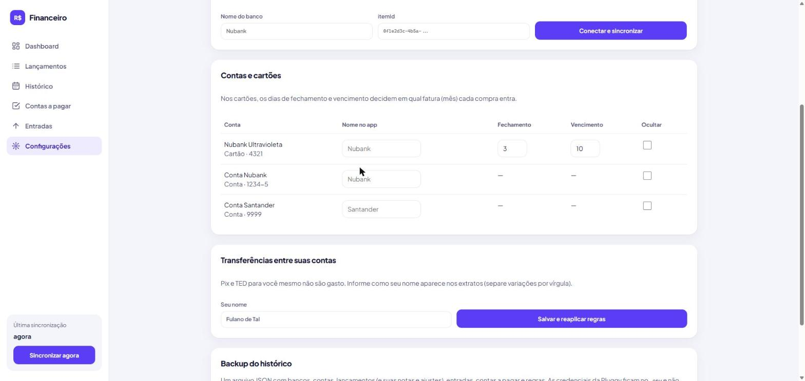

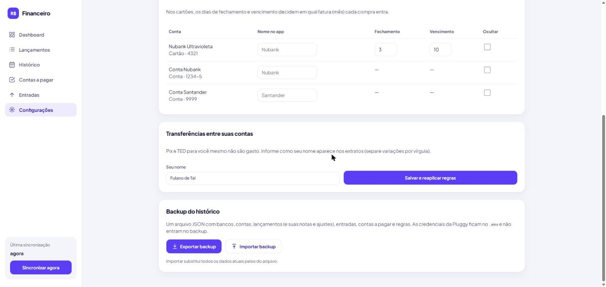

As credenciais da Pluggy (`.env`) **não** entram no backup. Ao restaurar em outra máquina, preencha o `.env` de novo.
Outra forma de backup é copiar a pasta `data/` do projeto com o container parado.

## 14. Regras automáticas

A cada sincronização, o app classifica os lançamentos sozinho. Tudo pode ser corrigido em [Lançamentos](#8-lançamentos).

| Situação | O que o app faz |
|---|---|
| Pagamento de fatura na conta corrente | Não conta como gasto, porque as compras já contam no cartão |
| Aplicação ou resgate (CDB, RDB, caixinha, poupança…) | Não conta como gasto |
| Pix ou TED para você mesmo | Não conta, se seu nome estiver em Configurações |
| Compra no cartão | Conta no mês da **fatura**, pelos dias de fechamento e vencimento |
| Compra parcelada | Cada parcela conta no mês da sua fatura; as próximas entram na previsão |
| Estorno no cartão | Abate do gasto do mês |
| Fatura do cartão | Vira uma conta a pagar, com baixa automática quando o pagamento aparece |
| Saída que se repete todo mês | Aparece como sugestão em Contas a pagar |
| Pix, boleto, TED, débito | Identificados pelo dado da Pluggy ou pela descrição |
| Conta marcada como paga sem lançamento do banco | Conta como saída do mês, em "Cadastrado por você"; quando o lançamento aparece, é ligado a ela, passa para "Dos bancos" e conta uma vez só |
| Investimento resgatado ou que sumiu da Pluggy | Sai da seção Saldos na próxima sincronização |

---

# Ajuda

## 15. Solução de problemas

Erros de um banco aparecem em vermelho na linha dele, em **Configurações**, e o rodapé do menu mostra
"Falha na última sincronização":

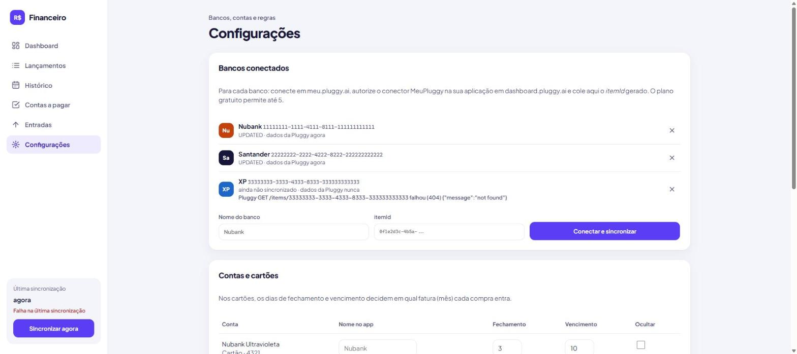

| Sintoma | Causa provável | O que fazer |
|---|---|---|
| `financeiro.localhost` não abre | Container parado, ou porta 80 ocupada por outro programa | Rode `docker compose up -d` e veja o erro; se a 80 estiver em uso, troque `APP_HTTP_PORT` no `.env` |
| Aviso "Pluggy não configurada" | `.env` vazio ou container não reiniciado | Preencha o `.env` e rode `docker compose up -d` |
| `Pluggy /auth falhou (401)` ou `(403)` | Client ID ou Secret errados, ou secret regenerado | Confira o `.env`; se gerou um secret novo, atualize-o |
| `GET /items/... falhou (404)` | `itemId` errado ou de outra aplicação | Copie de novo o `itemId` no Demo da mesma aplicação do `.env` |
| Banco cadastrado, mas sem contas | Banco autorizado sem o conector MeuPluggy, ou autorização incompleta | Refaça o [passo 7 do guia da Pluggy](configurar-pluggy.md#7-gerar-o-itemid-de-cada-banco) usando o **MeuPluggy** |
| "O plano gratuito permite até 5 conexões" | Limite do Meu Pluggy | Remova um banco para incluir outro |
| Compra do cartão no mês errado | Fechamento/vencimento diferentes da fatura real | Ajuste em [Configurações → Contas e cartões](#13-configurações) |
| Pix para você contando como gasto | Nome não cadastrado ou diferente do extrato | Ajuste em [Configurações → Transferências](#13-configurações) |
| Selo "Funcionalidade MeuPluggy" nas telas | Pluggy sem credenciais no `.env` ou sem banco cadastrado | Siga a [Parte 1](#1-o-que-você-precisa-ter-em-mãos); o selo some sozinho |
| Investimentos não aparecem em Saldos | A Pluggy não envia investimentos para esse banco ou plano | Nada a fazer no app; o restante funciona normalmente |
| Pagamento contou duas vezes (conta paga à mão + Pix/boleto) | A conta não tem texto no extrato, então o app não ligou o lançamento a ela | Cadastre o texto no extrato da conta, ou desmarque "Conta no mês" no lançamento |
| Faturas do cartão não aparecem em Contas a pagar | A Pluggy não enviou faturas nem o vencimento da fatura aberta desse cartão | Sincronize de novo; se continuar, cadastre a fatura como conta mensal com o texto "pagamento de fatura" |
| Nenhuma sugestão de conta recorrente | Menos de 3 meses de lançamentos, ou valores e dias variando demais | Aguarde mais meses de dados ou cadastre a conta à mão |
| "Este arquivo não é um backup do Financeiro" | Arquivo errado ou editado | Use um arquivo gerado por **Exportar backup** |
| "Backup de uma versão mais nova do app" | Backup feito num app mais novo | Atualize o código e rode `docker compose up -d --build` |

Para ver os logs do container:

```bash
docker logs financeiro --tail 50
```
