# Configurando a Pluggy

Passo a passo para criar as contas na Pluggy, conectar os bancos e obter as credenciais e os `itemId`
que o app Financeiro usa. São duas contas separadas: **Meu Pluggy** (onde ficam os seus bancos) e
**Pluggy Dashboard** (onde fica a aplicação que dá acesso à API).

## Sumário

1. [Criar a conta no Meu Pluggy](#1-criar-a-conta-no-meu-pluggy)
2. [Conectar os bancos no Meu Pluggy](#2-conectar-os-bancos-no-meu-pluggy)
3. [Criar a conta no Pluggy Dashboard](#3-criar-a-conta-no-pluggy-dashboard)
4. [Onboarding do Dashboard e Client Secret](#4-onboarding-do-dashboard-e-client-secret)
5. [Conferir a aplicação e as credenciais](#5-conferir-a-aplicação-e-as-credenciais)
6. [Conferir o conector MeuPluggy](#6-conferir-o-conector-meupluggy)
7. [Gerar o itemId de cada banco](#7-gerar-o-itemid-de-cada-banco)
8. [Configurar o app Financeiro](#8-configurar-o-app-financeiro)
9. [Limites do plano gratuito](#9-limites-do-plano-gratuito)

---

## 1. Criar a conta no Meu Pluggy

1. Acesse https://meu.pluggy.ai e clique em **Criar conta gratuita**.

   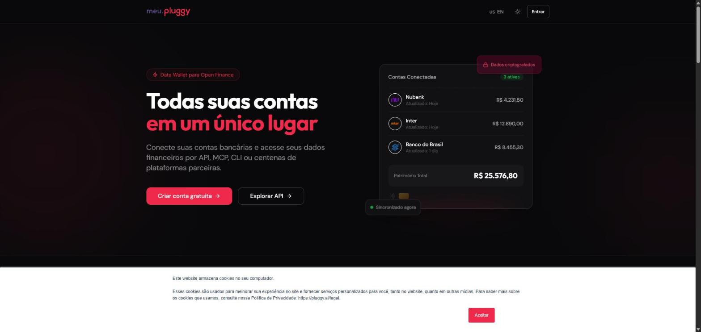

2. Entre com Google, GitHub, Microsoft ou Facebook, ou digite seu e-mail e clique em **ENVIAR**. Ao confirmar
   o e-mail, você aceita os Termos da Pluggy.

   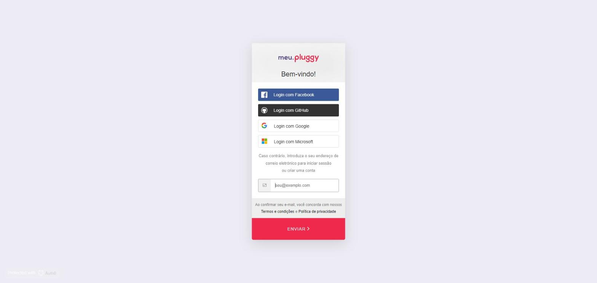

3. Defina a senha e confirme o e-mail pelo link que chega na caixa de entrada. Depois disso, você cai na tela **Overview**.

   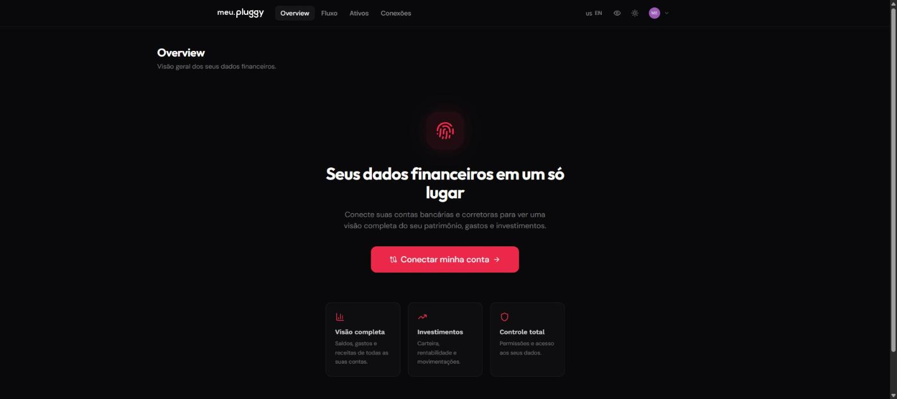

## 2. Conectar os bancos no Meu Pluggy

1. Clique em **Conectar minha conta** e depois em **Continuar**. Esse clique aceita os termos de conexão.

   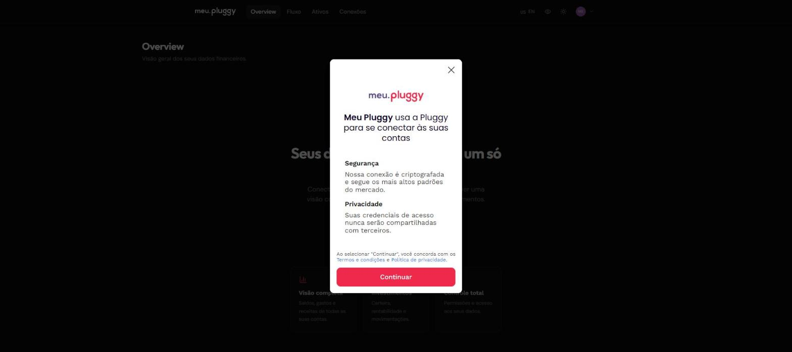

2. Escolha a instituição na lista (abas Pessoal, Empresas e Corretoras) ou use a busca.

   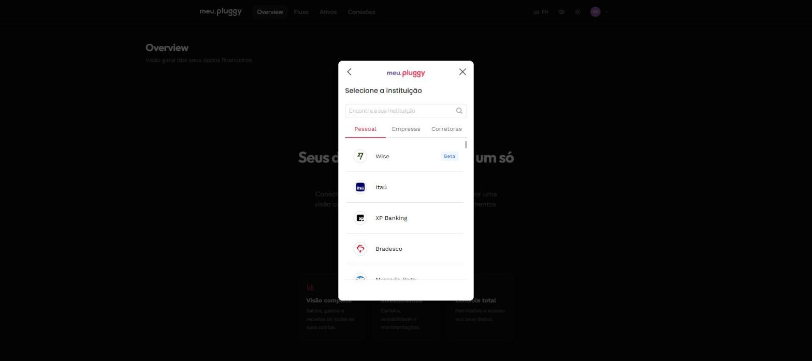
   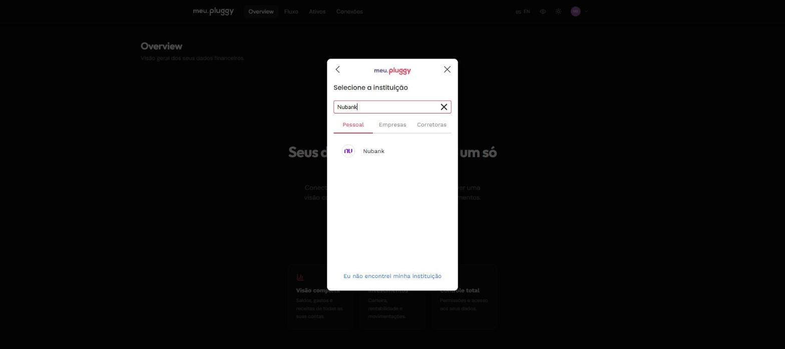

3. Informe o CPF do titular e clique em **Conectar**. Você será redirecionado ao app ou site do banco para
   autorizar o compartilhamento via Open Finance. **Vá até o fim da autorização** e volte para o Meu Pluggy;
   se você não voltar, a conexão não é criada.

   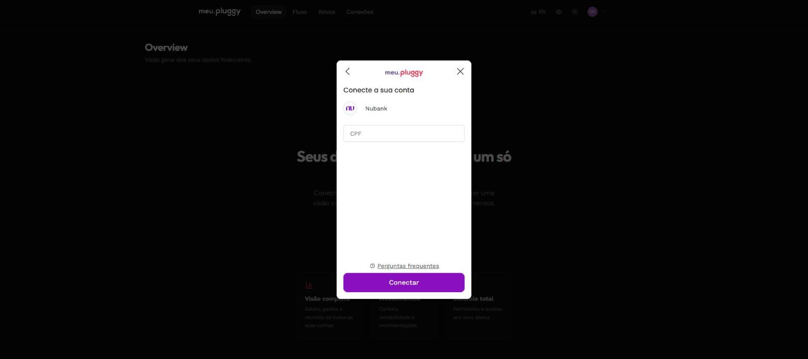

4. Repita o processo para cada banco. As conexões aparecem em **Conexões**. Depois do passo 7, a sua aplicação
   aparece em **Apps parceiros**.

   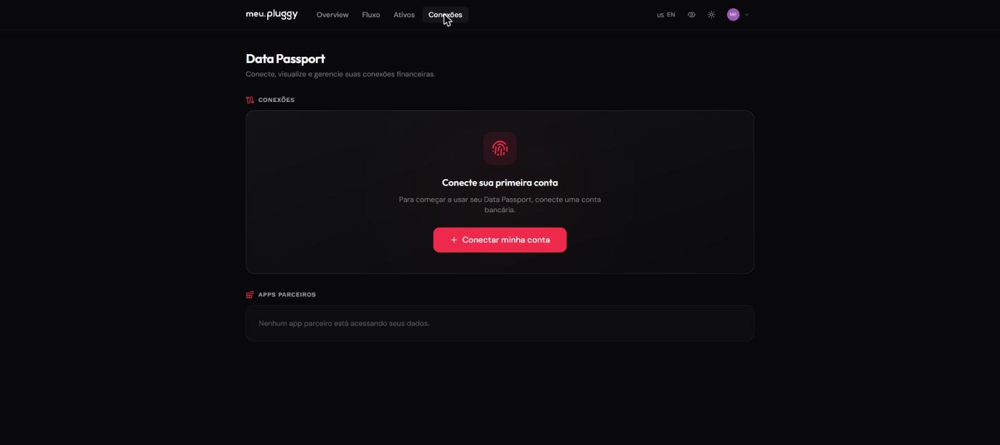

## 3. Criar a conta no Pluggy Dashboard

Acesse https://dashboard.pluggy.ai e clique em **Registrar**. Pode usar o mesmo e-mail do Meu Pluggy. Confirme o e-mail.
O aviso de trial de 15 dias não limita o uso pessoal.

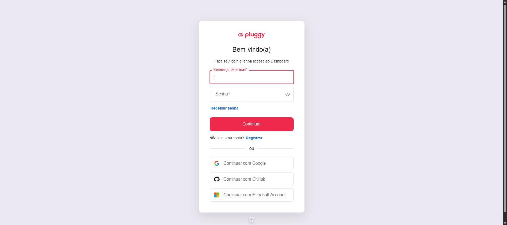

## 4. Onboarding do Dashboard e Client Secret

No primeiro acesso, o Dashboard abre um onboarding de 5 passos e **cria uma aplicação de desenvolvimento**
automaticamente ("Pluggy Demo App"). Se você fechar o onboarding, ele fica em **Primeiros Passos**, no menu lateral.

1. **Conte-nos sobre você:** escolha **Uso pessoal** e o seu papel. Na tela seguinte, marque as tecnologias (opcional).

   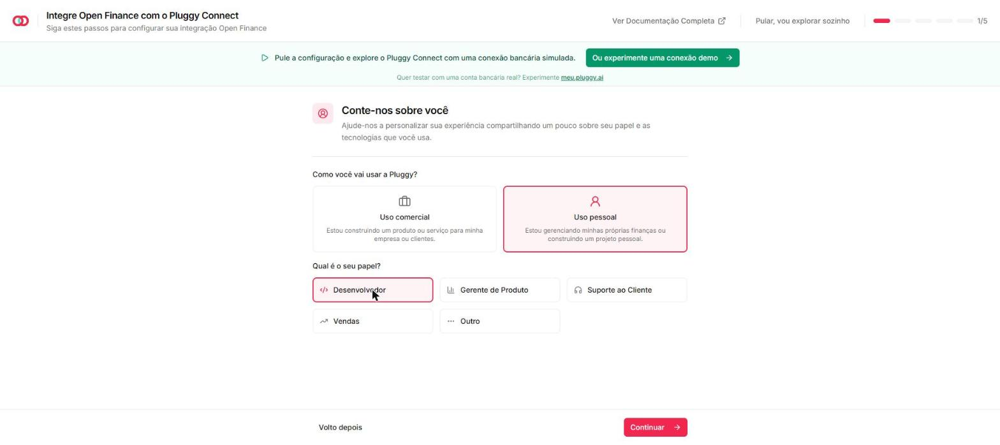
   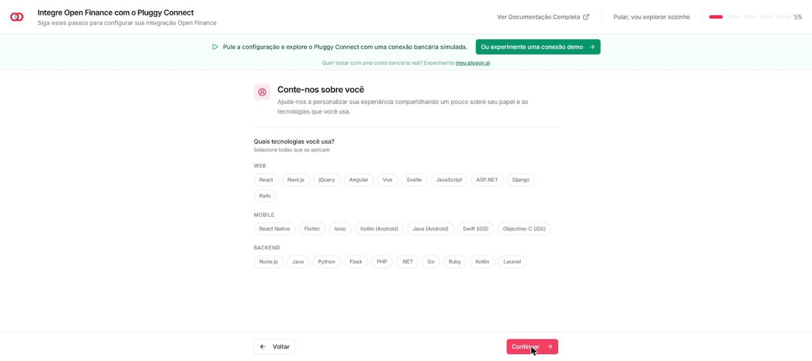

2. **Suas credenciais:** mostra o **Client ID**. Clique em **Gerar client secret** e **copie o secret na hora**,
   porque ele só é exibido uma vez.

   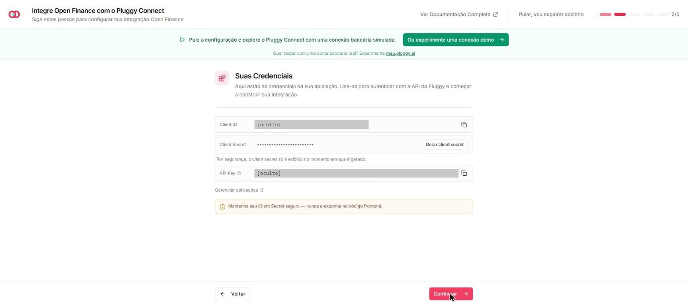

3. **Connect Token**, **Instalar Pluggy Connect** e **Webhooks:** servem para quem embute o widget num site.
   O app Financeiro não usa nada disso, então é só clicar em **Continuar** até **Finalizar Configuração**.

   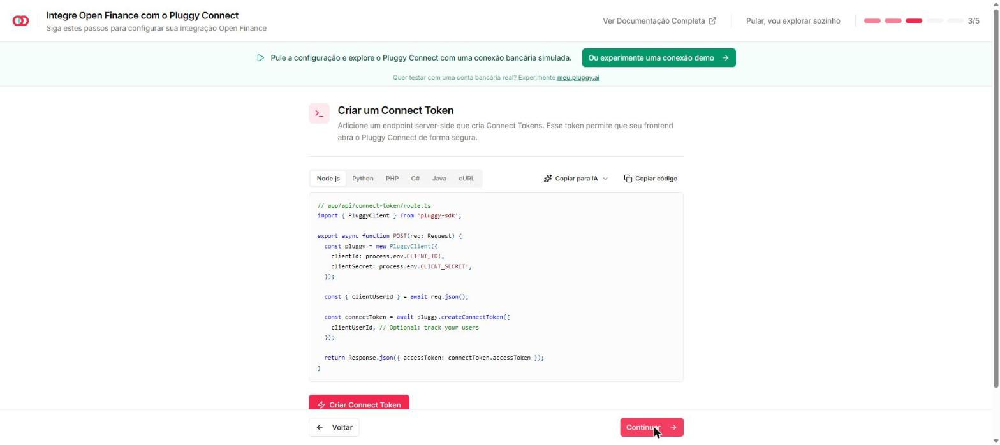
   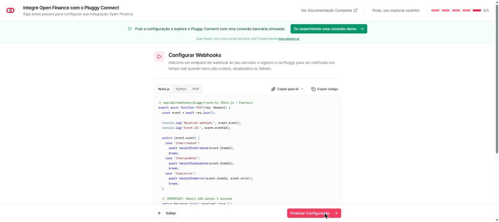

## 5. Conferir a aplicação e as credenciais

Em **Aplicações**, aparece a "Pluggy Demo App" (Development), com o Client ID e o Client Secret mascarado.
Não é preciso criar outra aplicação.

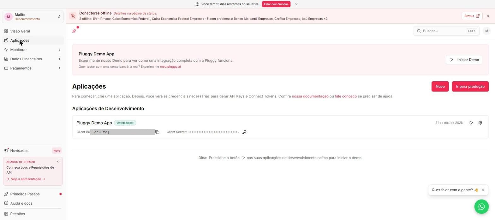

Clique na engrenagem para abrir os detalhes. Se você perdeu o secret, use **Gerar novo secret**. O anterior deixa
de funcionar na hora, então atualize o `.env`.

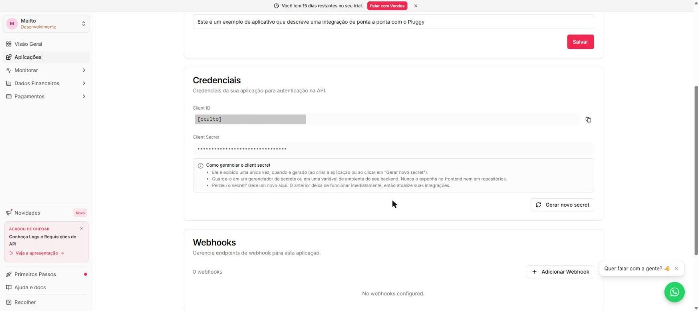

## 6. Conferir o conector MeuPluggy

Em **Dados Financeiros → Customização → Conectores**, a opção **Padrão para todos selecionados** já vem ligada.

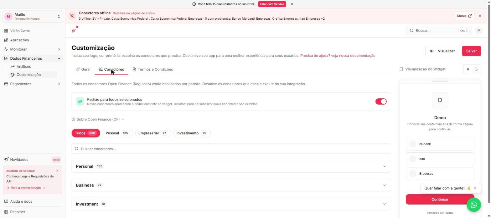

Para conferir, busque `MeuPluggy` e abra **Personal → Conectores Diretos**. O **(200) MeuPluggy** deve aparecer
habilitado. Se você desligou o padrão, ative esse conector e clique em **Salvar**.

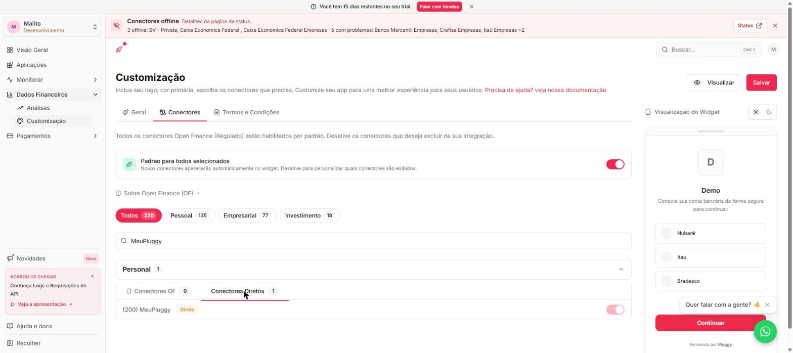

## 7. Gerar o itemId de cada banco

A API não lista as conexões. Cada banco precisa ser autorizado uma vez pela aplicação, e isso gera um `itemId`.

1. Em **Aplicações**, clique no ▶ da aplicação (**Iniciar Demo**) e depois em **Conectar Conta**.

   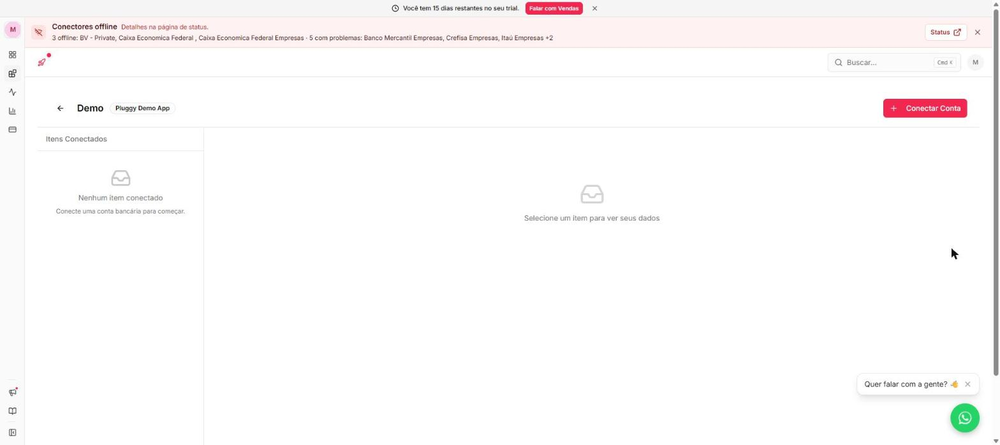

2. Clique em **Continuar** para aceitar os termos do widget.

   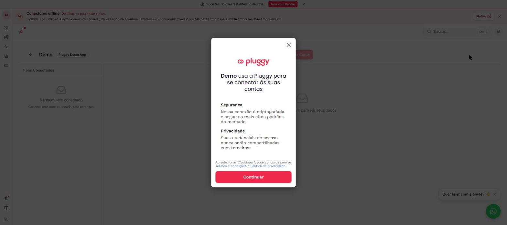

3. Busque e selecione **MeuPluggy**. Não use o conector do banco nem o Sandbox.

   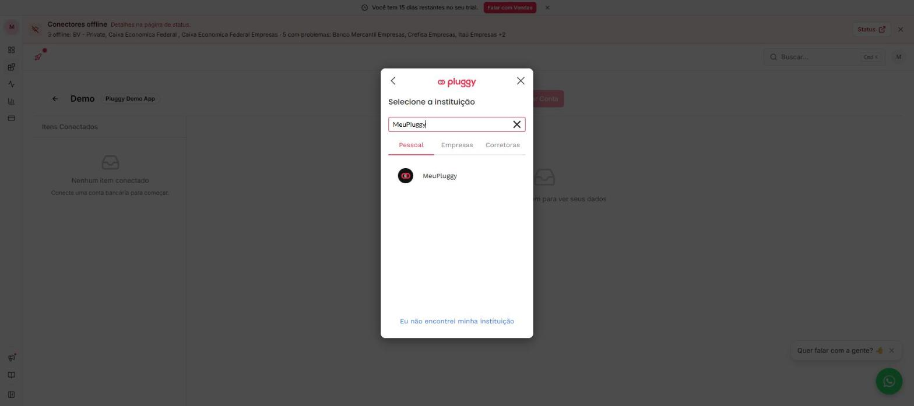

4. Clique em **Continuar**, entre com a sua conta do Meu Pluggy e escolha qual banco compartilhar.

   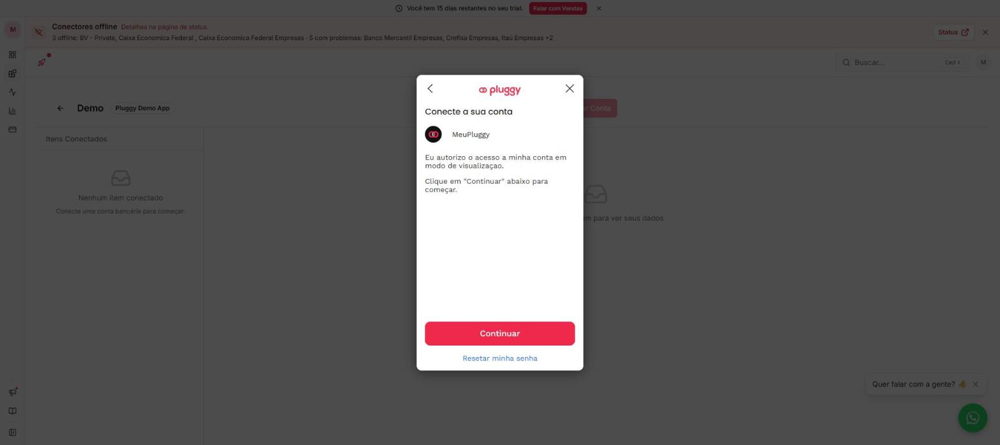

5. O item aparece em **Itens Conectados**, na tela do Demo. Selecione-o e copie o **id** (um UUID). Esse é o `itemId`.
6. Repita os passos 1 a 5 para cada banco conectado no Meu Pluggy.

## 8. Configurar o app Financeiro

1. Na raiz do projeto, preencha o `.env`:

   ```env
   PLUGGY_CLIENT_ID=<Client ID do passo 5>
   PLUGGY_CLIENT_SECRET=<Client Secret do passo 4>
   ```

2. Reinicie o container:

   ```bash
   docker compose up -d
   ```

3. Em http://localhost:47815, vá em **Configurações → Bancos conectados**, informe o nome do banco e cole o `itemId`.
   O app sincroniza na hora.

## 9. Limites do plano gratuito

- Até **5 conexões**, todas do mesmo titular. Contas de outras pessoas exigem plano pago.
- A Pluggy atualiza os dados **1 vez por dia**.
- O acesso é **somente leitura**: nada é movimentado nas suas contas.
